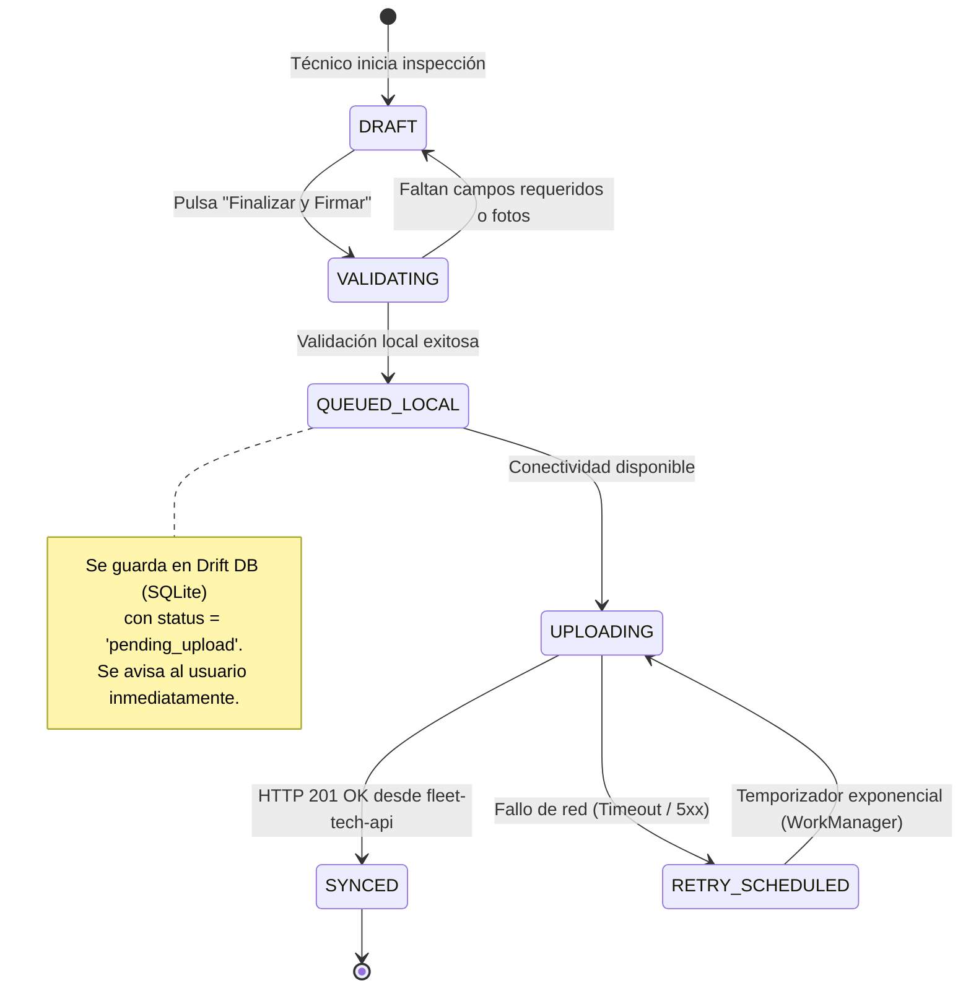
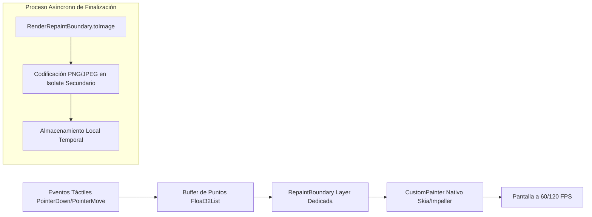

# 🏛️ Arquitectura Detallada de Fleet Tech Mobile

Documento técnico de diseño de software para la aplicación móvil Flutter de **Fleet Tech**, enfocado en estabilidad offline, desacoplamiento modular y renderizado óptimo a 60/120 FPS.

---

## 📐 1. Diagrama de Capas y Flujo de Datos

```mermaid
flowchart TD
    subgraph UI_Layer ["Capa de Presentación (Flutter UI)"]
        W[Widgets / Screens]
        RP[Riverpod StateNotifier / AsyncNotifier]
        W -->|Eventos de Usuario / Input| RP
        RP -->|Emite Estados Inmutables| W
    end

    subgraph Domain_Layer ["Capa de Dominio (Pure Dart / POJO)"]
        UC[Use Cases / Interactors]
        ENT[Entities & Value Objects]
        IRepo[Repository Contracts / Interfaces]
        RP -->|Ejecuta Caso de Uso| UC
        UC -->|Manipula Reglas de Negocio| ENT
        UC -->|Solicita Datos a través de Contrato| IRepo
    end

    subgraph Data_Layer ["Capa de Datos (Infraestructura)"]
        RepoImpl[Repository Implementation]
        IRepo -.->|Implementado por| RepoImpl
        
        LDS[Local Data Source\n(Drift SQLite + SecureStorage)]
        RDS[Remote Data Source\n(Dio Client + Interceptors)]
        
        RepoImpl -->|Lee/Escribe en Base Local| LDS
        RepoImpl -->|Sincroniza con Red| RDS
    end

    subgraph Backend ["Servicios Externos"]
        RDS -->|HTTPS REST Sanctum| API[fleet-tech-api]
        RDS -->|Subida de Fotos| S3[Storage / MinIO]
    end
```

---

## 🔄 2. Máquina de Estados del Motor Offline-First

Para garantizar que un técnico en un patio subterráneo o zona remota sin señal celular pueda completar inspecciones de pre-uso sin interrupciones, el sistema implementa una cola de persistencia local indexada en Drift (SQLite):



### Reglas de Sincronización:
1. **Prioridad de Subida:** Los datos tabulares (JSON de respuestas, odómetro, firmas base64) se envían primero en una solicitud atómica.
2. **Subida Asíncrona de Fotos:** Las imágenes de evidencia comprimidas se envían secuencialmente con indicador de progreso independiente.
3. **Manejo de Conflictos:** Si la unidad ya fue relevada por otro usuario mientras el dispositivo estaba offline, la API retorna código `409 Conflict`, y la app almacena una copia de auditoría local para conciliación con el supervisor.

---

## 🎨 3. Arquitectura del Lienzo de Firmas sin Lag (Dual Signature Canvas)

El relevo de turno requiere la firma tanto del operador saliente como del entrante en una única vista interactiva. Para evitar caídas de cuadros (*frame drops*):



- **Por qué funciona:** Al encapsular el widget de firma dentro de un `RepaintBoundary`, Flutter crea un `Layer` gráfico independiente. Cuando el dedo o lápiz se desplaza sobre la pantalla, el motor de renderizado marca únicamente ese `Layer` como *dirty*, evitando volver a procesar el árbol de widgets circundante (textos, botones, cabeceras).

---

## 📋 4. Renderizado de Checklists Dinámicos por Secciones

Las listas de chequeo son generadas dinámicamente según la plantilla retornada por `fleet-tech-api/checklist-templates/{id}`.

### Estrategia de Widgets:
1. **Virtualización con `SliverList`:** Cada sección de la inspección ("Cabina", "Motor", "Luces", "Custodia de Herramientas") se renderiza mediante un `SliverMainAxisGroup` con cabeceras ancladas (*sticky headers*).
2. **Desacoplamiento de Campos:** Cada ítem (`ChecklistItemTile`) gestiona su estado interno con un proveedor Riverpod familiar `itemStateProvider(itemId)`. De esta forma, si el técnico marca "Conforme" o "Defecto", **únicamente ese ítem individual actualiza su interfaz**, mientras los otros 59 ítems permanecen inmutables en memoria.

---

## 🛡️ 5. Resiliencia y Manejo de Errores

| Tipo de Excepción | Causa Probable | Estrategia de Mitigación en Flutter |
| :--- | :--- | :--- |
| `SocketException` / `TimeoutException` | Falta de cobertura en patio | Reintento automático con jitter y persistencia en la cola Drift |
| `DioException (401 Unauthorized)` | Token Sanctum expirado o revocado | Disparar evento de cierre de sesión, purgar credenciales en SecureStorage y redirigir a Login |
| `DioException (422 Unprocessable)` | Violación de reglas de validación en backend | Mapear matriz `errors` del payload JSON directamente a los campos de formulario específicos |
| `OutOfMemoryError (OOM)` | Demasiadas fotografías en resolución completa | Redimensionar fotos a 1080p WebP/JPEG antes de cargarlas en la interfaz; usar `memCacheWidth` en listas |
