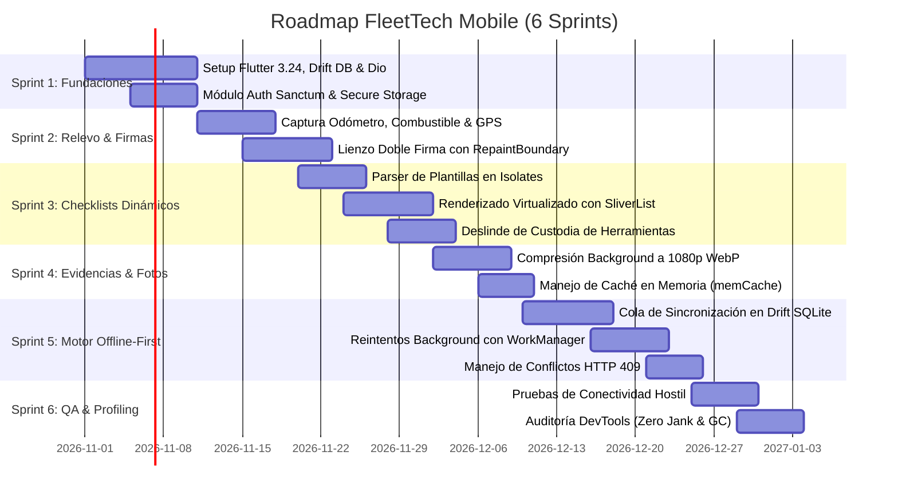

# 📱 Roadmap de Desarrollo - Fleet Tech Mobile (Flutter)

Planificación de hitos, sprints y tareas técnicas exclusivas para el desarrollo de la aplicación móvil en Flutter, garantizando soporte **Offline-First**, renderizado a **60/120 FPS** y sincronización con `fleet-tech-api`.

---

## 📅 Sprints de Desarrollo

---

## 🎯 Detalle por Sprint

### Sprint 1: Fundaciones, Arquitectura y Autenticación
- Configuración de `flutter_riverpod` con code-generation (`@riverpod`).
- Configuración del cliente `dio` con interceptores para encabezados `Authorization: Bearer <token>` y manejo de códigos `401`.
- Base de datos local **Drift (SQLite)** con tablas iniciales de usuario y catálogo de vehículos.
- Pantalla de Login con almacenamiento seguro en **Flutter Secure Storage** (KeyStore / KeyChain).

### Sprint 2: Relevo de Turno y Doble Firma Vectorial
- Formulario de relevo: ingreso de odómetro validado, selector táctil de nivel de combustible en octavos (1/8 a 8/8) y número de bahía.
- Captura de coordenadas GPS en segundo plano con verificación de precisión.
- Lienzo de doble firma (operador saliente y entrante) aislado con `RepaintBoundary` para garantizar 60/120 FPS sin lag en el trazo.

### Sprint 3: Renderizado de Checklists Dinámicos
- Parser JSON en segundo plano (`Isolate.run()`) para plantillas con más de 60 preguntas.
- Renderizador de secciones y preguntas con `SliverList` y `prototypeItem`.
- Desacoplamiento de campos con selectores atómicos de Riverpod para evitar repintar la lista completa al marcar una opción.
- Lógica de custodia de herramientas: ítems marcados como daño o faltante generan alerta de defecto en el acto.

### Sprint 4: Captura y Optimización de Evidencias Fotográficas
- Captura de fotos con cámara nativa o galería.
- Compresión asíncrona con `flutter_image_compress` a resolución máxima 1080p WebP/JPEG 80% en un Isolate secundario.
- Asignación de `memCacheWidth` y `memCacheHeight` en widgets de imagen para prevenir errores Out Of Memory (OOM) y pausas de Garbage Collection.

### Sprint 5: Motor Offline-First y Resiliencia
- Tabla `sync_queue` en Drift para registrar inspecciones completadas con estado `pending_upload`.
- Integración de `workmanager` para sincronización periódica en segundo plano cuando se detecte conexión.
- Generación de UUID v4 para el encabezado `Idempotency-Key` en cada inspección para evitar duplicados en el backend.
- Manejo de respuestas `HTTP 409 Conflict` (vehículo ya relevado por otro operario).

### Sprint 6: Estabilización, QA y Profiling
- Pruebas en terminales físicos de gama baja y media.
- Verificación con Flutter DevTools:
  - Tasa de refresco > 55 FPS en scroll y firma.
  - Tiempos de UI Isolate y Raster Isolate < 8.3ms / 16.6ms.
  - Cero fugas de memoria (memory leaks) al cerrar formularios de inspección.
