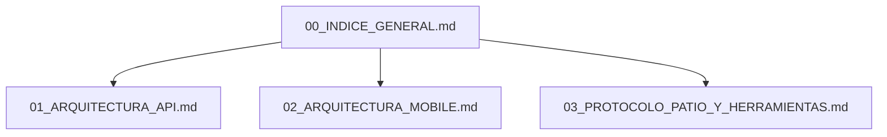

# 🚛 FleetTech - Índice General de Documentación Técnica

Documentación técnica y operativa del ecosistema **FleetTech** alojada internamente en el proyecto.

---

## 🗺️ Mapa de Documentación

---

## 📑 Módulos Disponibles

### [01. Arquitectura General y Contratos API](./01_ARQUITECTURA_API.md)
* Arquitectura técnica del Backend Laravel 12/13 en PHP 8.3 con PostgreSQL 16.
* Diccionario de Base de Datos y Enums nativos (`VehicleStatus`, `ShiftType`, `DefectSeverity`, etc.).
* Catálogo oficial de endpoints RESTful `/api/v1/...` con contratos JSON (Envelopes).
* Mecanismo de autenticación con Laravel Sanctum y control de roles.

### [02. Especificación Técnica y Arquitectura Mobile](./02_ARQUITECTURA_MOBILE.md)
* Arquitectura Feature-First Clean Architecture en Flutter para operadores de patio.
* Estrategia Offline-First con sincronización en cola (almacenamiento local seguro).
* Motor de captura de evidencias: compresión de fotos antes de envío y geolocalización GPS.
* Módulo de doble firma digital táctil con exportación PNG transparente.
* Optimización de rendimiento para dispositivos de gama media/baja en campo.

### [03. Protocolo Operativo de Patio y Custodia de Herramientas](./03_PROTOCOLO_PATIO_Y_HERRAMIENTAS.md)
* Flujo de trabajo de los operadores: Turno Mañana $\leftrightarrow$ Turno Tarde $\leftrightarrow$ Turno Noche.
* Protocolo de auditoría del kit de herramientas dotado por la empresa y deslinde legal de responsabilidades.
* Lógica de bloqueo preventivo inmediato (`in_maintenance`) ante fallas mecánicas o de seguridad críticas.
* Proceso de cierre de defectos y liberación de unidades por parte del equipo técnico de taller.
