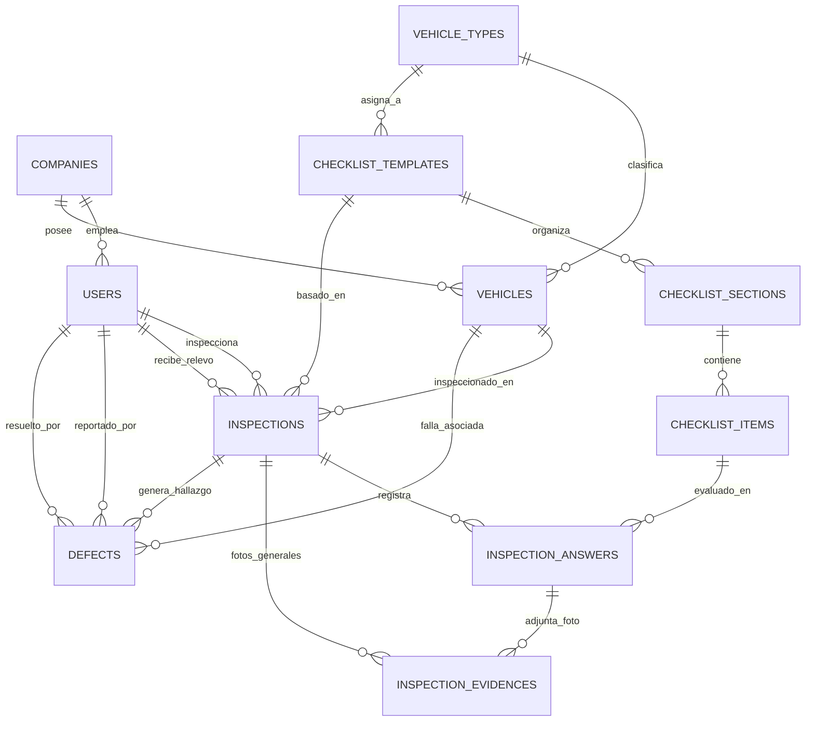

# 01. Arquitectura General del Ecosistema y Contratos API

Este documento detalla la estructura del backend central **FleetTech API**, sus modelos de base de datos en PostgreSQL 16 y los contratos de integración para las aplicaciones cliente.

---

## 🏛️ 1. Arquitectura de Software Backend (Laravel 12/13 MVC)

El backend implementa el patrón clásico **MVC estructurado y limpio**:

```text
app/
├── Enums/                 # BackedEnums PHP 8.3 (UserRole, ShiftType, VehicleStatus, etc.)
├── Models/                # Modelos Eloquent con relaciones y casts nativos
├── Services/              # Lógica de negocio (InspectionService, DefectService)
└── Http/
    ├── Controllers/Api/   # Controladores RESTful delgados
    ├── Requests/Api/      # FormRequests de validación estricta
    └── Resources/Api/     # ApiResources con Envelope estandarizado
```

---

## 📊 2. Diagrama de Base de Datos y Relaciones



---

## 🔌 3. Catálogo de Endpoints RESTful (`/api/v1/...`)

Todas las respuestas cumplen con el estándar corporativo:
```json
{
  "success": true,
  "message": "Mensaje descriptivo",
  "data": { ... },
  "meta": { "timestamp": "2026-10-26T15:00:00Z" }
}
```

### A. Autenticación y Perfil
* `POST /api/v1/auth/login`: Retorna Bearer token de Sanctum, datos de usuario, rol y empresa.
* `GET /api/v1/auth/me`: Consulta datos del usuario autenticado.
* `POST /api/v1/auth/logout`: Revoca el token actual.

### B. Flota y Padrón Vehicular de Patio
* `GET /api/v1/vehicle-types`: Listado de tipos de unidad (Tractocamiones, Cisternas, Camionetas).
* `GET /api/v1/vehicles`: Listado de unidades en patio (filtros `?status=active|in_maintenance` y búsqueda `?search=ABC`).
* `GET /api/v1/vehicles/{id}`: Ficha técnica completa de la unidad con specs JSONB y defectos abiertos.
* `POST /api/v1/vehicles`: Alta de unidad en sistema.

### C. Plantillas Maestras de Checklist
* `GET /api/v1/checklist-templates`: Plantillas activas de patio.
* `GET /api/v1/checklist-templates/{id}`: Formulario dinámico con secciones anidadas, preguntas del kit de herramientas y banderas `requires_photo_on_fail`.

### D. Inspecciones y Relevo de Turno
* `GET /api/v1/inspections`: Historial de inspecciones filtrable por turno, vehículo y estado.
* `GET /api/v1/inspections/{id}`: Detalle de inspección con respuestas, evidencias y firmas.
* `POST /api/v1/inspections`: **Relevo de patio.** Almacena odómetro, combustible, doble firma, fotos de evidencia y genera defectos automáticos con bloqueo preventivo ante fallas críticas.

### E. Defectos y Taller
* `GET /api/v1/defects`: Monitor de fallas en patio/taller.
* `GET /api/v1/defects/{id}`: Detalle de la falla.
* `PATCH /api/v1/defects/{id}/resolve`: El técnico registra notas de solución y foto del trabajo terminado; si no quedan defectos críticos abiertos, desbloquea la unidad a `active`.
