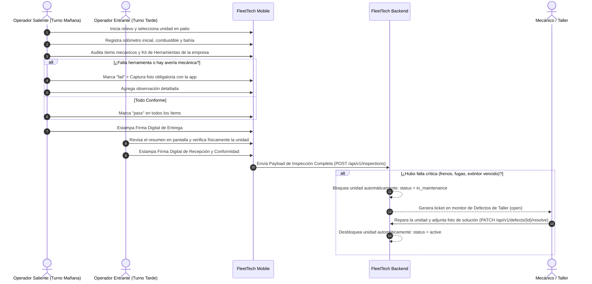

# 03. Protocolo Operativo de Patio, Relevo de Turnos y Custodia de Herramientas

Este documento describe las reglas de negocio y los flujos operativos que regulan el cambio de turno entre operadores, la trazabilidad estricta de las herramientas asignadas a cada unidad y el procedimiento ante fallas mecánicas en el patio.

---

## 🔄 1. Ciclo de Relevo de Turnos entre Operadores

---

## 🛠️ 2. Custodia y Deslinde de Responsabilidad sobre Herramientas

Las herramientas son dotadas por la empresa (gata hidráulica de botella 20T, llave de ruedas tipo cruz con dado, triángulos de seguridad reflectivos, conos de 28 pulgadas, extintor PQS 6kg, botiquín de emergencia, escáner automotriz y linterna de patio).

> [!IMPORTANT]
> **Regla de Deslinde de Responsabilidades:**
> Si un operador del turno saliente no reporta una herramienta faltante o dañada, la responsabilidad recae automáticamente sobre su turno. Al firmar el relevo, el operador entrante da fe de que recibió todas las herramientas completas o que las novedades reportadas ya quedaron documentadas con foto en el sistema.

---

## 🚫 3. Bloqueo Preventivo Inmediato de Unidades en Patio

Para garantizar la seguridad de la operación y evitar accidentes:

* **Severidad Crítica (`DefectSeverity::CRITICAL`):**
  * Falla o fuga en el sistema de frenos de aire.
  * Fuga activa de combustible o aceite de motor.
  * Ausencia o vencimiento de extintor de seguridad reglamentario.
  * Neumático liso por debajo de la norma legal (< 1.6 mm).
* **Acción Inmediata del Sistema:**
  * La unidad pasa automáticamente a **`in_maintenance`**.
  * En la app móvil y en la web se muestra con un distintivo **ROJO** de advertencia indicando que la unidad no puede abandonar el patio ni ser operada hasta que el taller levante la observación.
